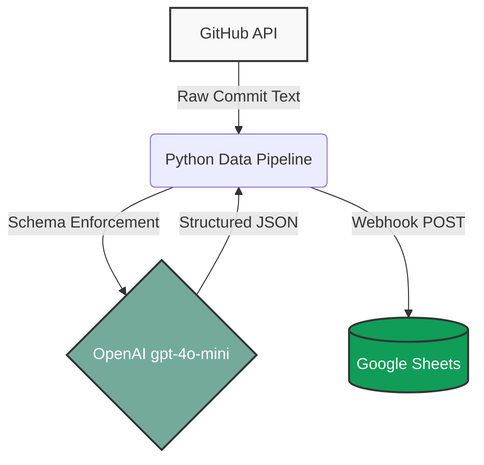

# 🌱 Campus Eco-Footprint AI Tracker

# ⚡ Multi-Source Live API Data Summarizer & Pipeline

An automated data pipeline combining GitHub REST APIs, OpenAI Structured Outputs (Pydantic), and Google Apps Script Webhooks to extract, validate, and persist executive intelligence from unstructured developer commit feeds. 

## Architecture
1. **Extraction**: Ingests raw commit text from public GitHub repositories using requests.
2. **Schema Enforcement**: Leverages OpenAI beta.chat.completions.parse with strict Pydantic schemas to extract key_topic, sentiment, action_items, and urgency_level.
3. **Automated Loading**: Dispatches the validated JSON payload to an asynchronous Google Sheets webhook receiver deployed on Google Apps Script.

## Tech Stack
- **Language**: Python 3.12
- **Validation**: Pydantic v2
- **AI Engine**: OpenAI API (gpt-4o-mini)
- **Integration**: Google Apps Script Webhook receiver, Google Sheets

## Local Setup
1. Clone repository and navigate to the project:
   cd ai-summarizer
2. Create and activate a virtual environment:
   python3 -m venv venv
   source venv/bin/activate
3. Install dependencies:
   pip install -r requirements.txt
4. Set up .env:
   OPENAI_API_KEY=your_openai_api_key_here
5. Run the pipeline:
   python main.py

