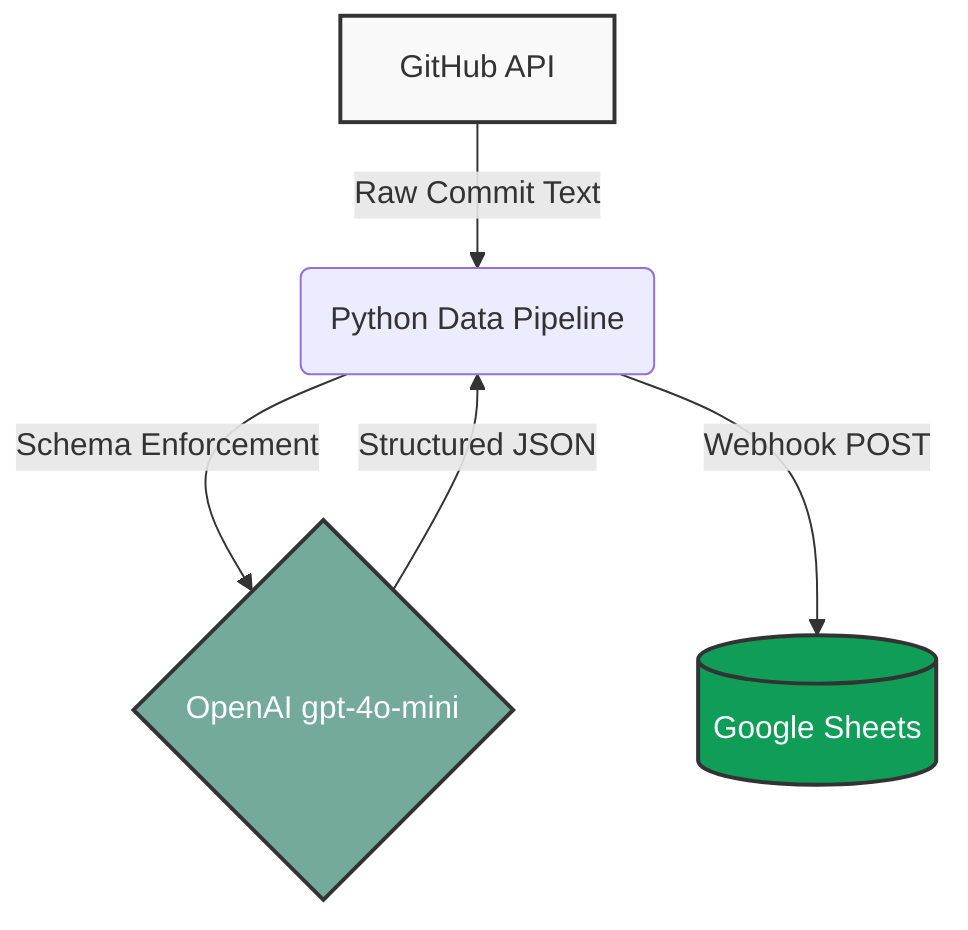

# ⚡ Multi-Source Live API Data Summarizer & Pipeline

An automated data pipeline combining GitHub REST APIs, OpenAI Structured Outputs (Pydantic), and Google Apps Script Webhooks to extract, validate, and persist executive intelligence from unstructured developer commit feeds.

## Architecture

## Tech Stack
- **Language**: Python 3.12
- **Validation**: Pydantic v2
- **AI Engine**: OpenAI API (gpt-4o-mini)
- **Integration**: Google Apps Script Webhook receiver, Google Sheets
